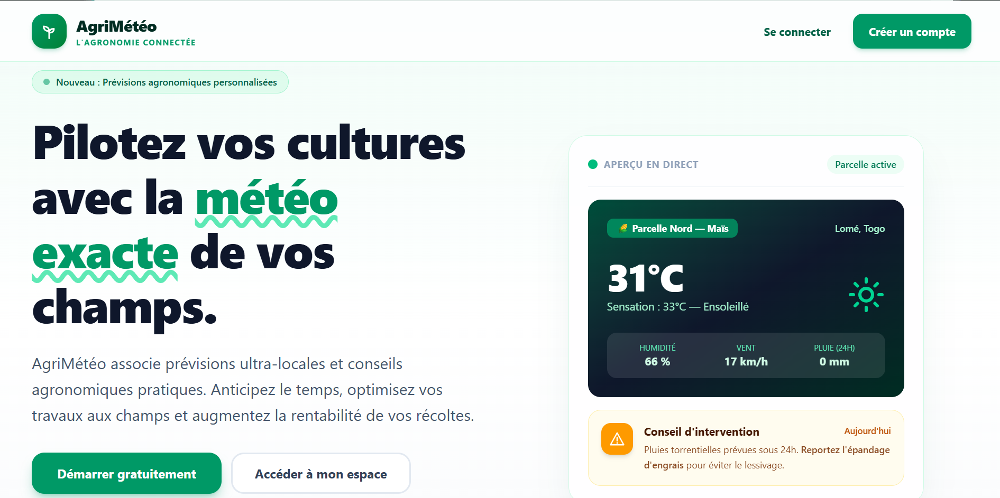

# AgriMétéo

Application web qui aide les agriculteurs à suivre leurs parcelles, leurs cultures et la météo, avec des conseils adaptés à chaque culture et à son stade de croissance.

**Site en ligne :** https://agrimeteo-tree.vercel.app



## Fonctions

- Inscription, connexion et déconnexion sécurisées
- Tableau de bord avec la météo actuelle et les prévisions sur 5 jours de chaque parcelle
- Gestion des parcelles : ajout, modification, suppression, localisation par recherche d'un lieu
- Gestion des cultures et des cycles de culture (dates de semis et de récolte)
- Relevés de terrain avec le stade de croissance
- Conseils générés selon la météo, le type de culture et son stade
- Chaque utilisateur ne voit que ses propres données

## Technologies

- Next.js 16 (App Router), React 19, TypeScript
- Tailwind CSS 4
- Prisma 7 avec MySQL
- Authentification par jeton JWT (jose) dans un cookie sécurisé, mots de passe hachés avec bcryptjs
- API OpenWeather pour la météo et la géolocalisation
- Déploiement : Vercel (application) et Aiven (base MySQL)

## Installer le projet en local

Prérequis : Node.js 20 ou plus, une base MySQL, une clé OpenWeather gratuite.

```bash
git clone https://github.com/JbDev-tech/agrimeteo.git
cd agrimeteo
npm install
```

Crée un fichier `.env` à la racine avec ces variables :

```env
MYSQL_HOST=localhost
MYSQL_PORT=3306
MYSQL_USER=root
MYSQL_PASSWORD=
MYSQL_DATABASE=agrimeteo
DATABASE_URL=mysql://root:@localhost:3306/agrimeteo
OPENWEATHER_API_KEY=ta_cle_openweather
AUTH_SECRET=une_longue_valeur_aleatoire
```

Pour une base qui exige SSL (comme Aiven), ajoute aussi `MYSQL_CA` avec le texte du certificat.

Crée les tables puis lance l'application :

```bash
npx prisma db push
npm run dev
```

L'application tourne sur http://localhost:3000.

## Sécurité

- Mots de passe jamais stockés en clair
- Cookie de session `httpOnly`, `secure` en production
- Chaque route vérifie que la ressource appartient à l'utilisateur connecté
- Les clés API et secrets restent côté serveur, hors du dépôt

## Prochaines étapes

- Carte interactive des parcelles
- Page de profil (changement de nom et de mot de passe, suppression du compte)
- Réinitialisation du mot de passe par e-mail
- Notifications d'alertes météo
- Photos des relevés
- Limitation des tentatives de connexion

## Auteur

Jean-Baptiste (JbDev-tech), développeur web au Togo.